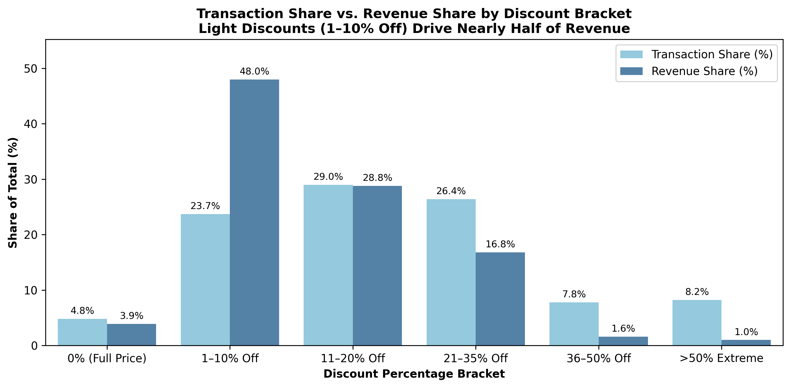
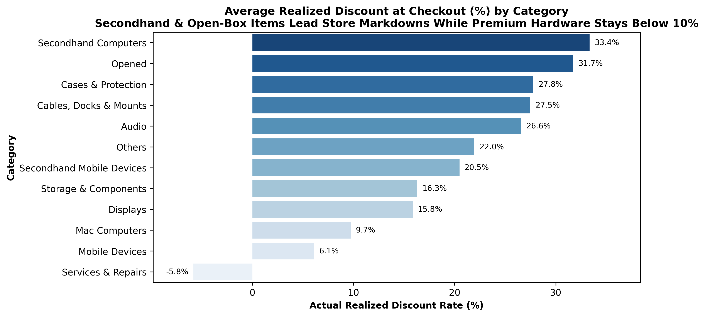
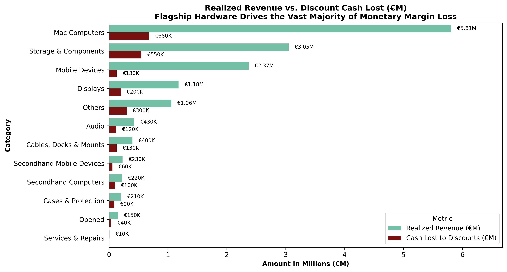
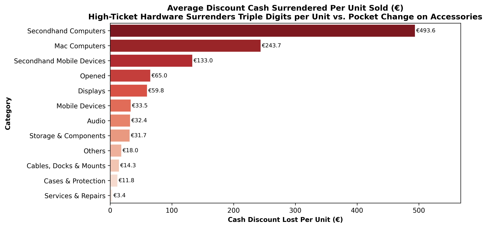

# ENIAC Discount Strategy & Margin Optimization Analysis

An end-to-end e-commerce pricing audit analyzing **7,546 verified catalog SKUs**, **44,344 completed orders** and **57,967 line items** (Jan 2017 – Mar 2018) to evaluate whether ENIAC's discounting practices drive profitable growth or erode cash margin.

---

## Executive Summary

Evaluating discounts strictly by percentage markdowns creates a costly blind spot:
* **Deep Discounts (>35%) Are Not the Problem:** Aggressive percentage cuts (25%–40%+) are confined to clearance/open-box stock and low-ticket accessories, generating negligible cash leakage.
* **Light Discounts (1%–10%) Drive Nearly Half of Revenue:** While accounting for **23.7%** of orders, the `1%–10%` bracket generates **48.0%** of total realized revenue (**€7.08M**).
* **Flagship Hardware Drives Monetary Margin Erosion:** **Mac Computers** carry an average discount of just **9.7%**, yet surrender **€682,024** in total cash margin (**€243.65 per unit sold**)—far exceeding every high-percentage accessory category.

---

## Key Analytical Findings

### 1. Promotional Efficiency by Discount Bracket
Extreme markdowns (`>35%`) generate operational noise with minimal top-line return (`2.6%` combined revenue share), whereas ENIAC's financial engine sits in the `1%–10%` bracket.



### 2. Realized Checkout Discounts Across Categories
Percentage discipline appears healthy on the surface: steep cuts are isolated to secondhand and open-box inventory, while flagship Apple hardware stays below 10%.



### 3. Total Monetary Margin Loss (€M)
Translating percentages into Euros reveals that **Mac Computers** are both ENIAC's #1 revenue generator (**€5.81M**) and #1 source of discount cash surrendered (**€680K**).



### 4. Unit Economics & The "Percentage Illusion"
Discounting an accessory by ~30% surrenders single-digit pocket change per unit, whereas a "modest" ~10% discount on a Mac Computer surrenders **€243.70** on every unit sold.



---

## Strategic Recommendations

1. **Enforce a 5%–7% Discount Cap on Mac Computers:** Tightening the ceiling by 3–5 percentage points recovers substantial net margin on every flagship sale without hurting accessory-driven traffic.
2. **Transition to Fixed-Euro Rebates (€100 Off):** Replacing percentage cuts with a flat **€100 rebate** on flagship hardware preserves strong psychological appeal at checkout while capping per-unit cash exposure.
3. **Preserve High-Percentage Promos for Clearance & Accessories:** Maintain `25%–35%+` markdowns strictly for open-box liquidation and high-margin accessories to protect basket conversion.

---

## Repository Structure

```text
├── README.md                                            # Executive overview & visual case study
├── eniac_discount_strategy_googlecolab_notebook.ipynb   # Full data cleaning, audit & visualization pipeline
├── data/
│   ├── clean/                                           # Audited & synchronized production datasets
│   └── raw/                                             # Original e-commerce catalog & order exports
├── docs/
│   ├── eniac_discount_strategy_presentation.pdf         # Executive slide deck
│   └── eniac_discount_strategy_presentation_script.pdf  # 4.5-minute presentation script
└── images/                                              # High-resolution charts (Sections 4 & 6 Appendix)
